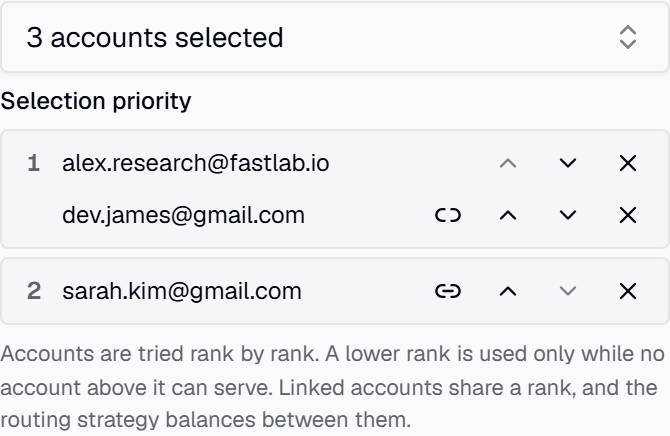

# API Key Authentication

API key auth is **disabled by default**. In that mode, only local requests to the protected proxy routes can
proceed without a key; non-local requests are rejected until proxy authentication is configured. Enable it in
**Settings → API Key Auth** on the dashboard when clients connect remotely or through Docker, VM, or container
networking that appears non-local to the service.

When enabled, clients must pass a valid API key as a Bearer token:

```
Authorization: Bearer sk-clb-...
```

## Protected routes

The protected proxy routes covered by this setting are:

- `/v1/*` (except `/v1/usage`, which always requires a valid key)
- `/backend-api/codex/*`
- `/backend-api/transcribe`

## Creating keys

Dashboard → API Keys → Create. The full key is shown **only once** at creation. Keys support optional expiration, model restrictions, and rate limits (tokens / cost per day / week / month).

Keys can also be scoped to specific accounts, so a key draws quota only from the accounts assigned to it:


### Account priority

The order of a key's assigned accounts is its selection priority. The proxy uses the top-ranked account while it can
serve and moves down one rank once it cannot: rate-limited, out of quota, paused, or above the sticky primary
threshold. A key's order outranks each account's routing policy (`burn_first`, `preserve`).

An ongoing conversation keeps its account while that account still holds a warm prompt cache, even if a
better-ranked account is free again. It returns to the key's best available rank once it has been idle for 10
minutes (the cache is cold by then, so the move costs nothing), and it leaves a `preserve` account as soon as a
non-`preserve` account can serve it. Hard continuation (`previous_response_id`, turn state, bridge sessions) always
stays on its owner. The request details' **Routing decision** names either move.

To let several accounts carry a key together, link an account to the one above it (the link button next to it in the
priority list). Linked accounts share a rank: the routing strategy balances between them, and their routing policy
decides which goes first. Through the API, send `assignedAccountTiers` (for example `[["acc-a", "acc-b"], ["acc-c"]]`)
instead of `assignedAccountIds`; a flat `assignedAccountIds` list still gives every account its own rank.



## Reasoning effort policies

A key can either enforce one reasoning effort or allow a selected non-empty set of client-requested efforts.
Leave the allowed-efforts selection empty to keep the existing unrestricted behavior. A request that explicitly
sets an effort outside its key's allowlist receives a `403 reasoning_effort_not_allowed` response. Requests that
omit a reasoning effort continue to use the model or upstream default.

The policy evaluates the effort selected by the client, including supported model aliases such as `-xhigh`.
Each configured effort is distinct: allowing `high` does not allow `xhigh`, and allowing `max` does not allow
`ultra`. The proxy still rewrites an allowed `ultra` request to the upstream wire value `max`.


For wiring keys into each client, see [Client Setup](client-setup.md).

---

*Spec: [api-keys](https://github.com/Soju06/codex-lb/tree/main/openspec/specs/api-keys),
[account-routing](https://github.com/Soju06/codex-lb/tree/main/openspec/specs/account-routing)*
